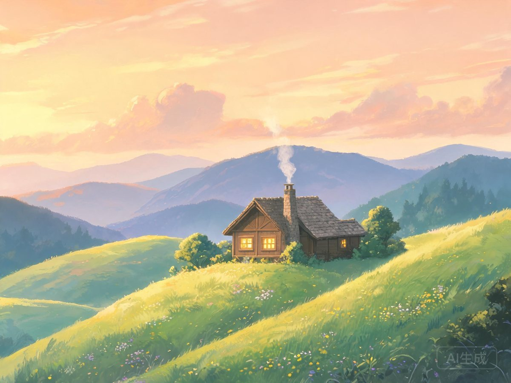
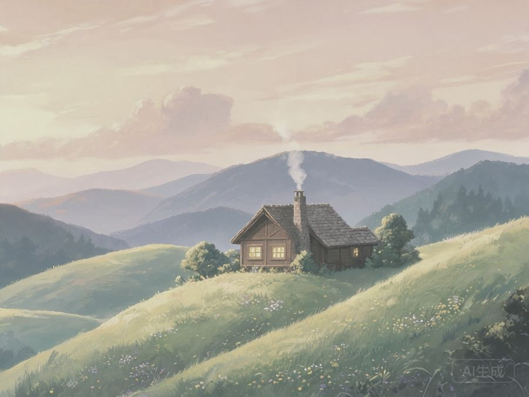

## 🎨 作品简介

这是一幅山间小屋的风景插画，尝试了新的配色方案。

## 过程对比

<!-- 第一版与最终版并排显示（均为本地图片，不依赖外部图床） -->

  

    <h4>🖼 第一版</h4>
    
    
最初的草稿，色调偏冷，层次不够分明。

  

  

    <h4>✨ 最终版</h4>
    
    
调整了光影，增加了暖色调，整体更有氛围感。

  

## 创作思路

画这幅画的时候脑子里想着秋天的清晨，雾气还没散去，阳光刚从山后照进来。

- **工具**：Procreate
- **用时**：约 4 小时
- **灵感**：某次爬山看到的景色
